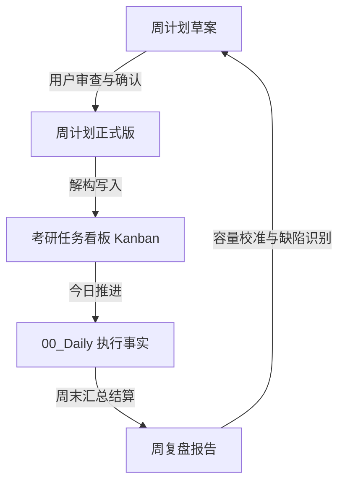

# Product Context: 考研备考全周期规划体系

## 1. 业务痛点与设计宗旨
考研备考面临海量资料、动态进度与复习焦虑。常见失败原因包括：计划频繁变更、执行事实失真、记录过度复杂占满学习精力、外部经验盲从。
本系统的设计核心：
- **极简摩擦**：每日记录耗时控制在 5 分钟内；
- **真实事实**：区分“计划”、“已生成材料”与“真实学过”；
- **严控负荷**：每日限制并发任务（进行中最多 1 项，今日最多 3 项），设置充足的周缓冲时间（如 14 小时缓冲）。

## 2. 核心用户与交互端分工
- **用户（备考者本人）**：唯一决策中枢。输入每日学习事实、确认正式计划、把控考试目标与时间底线。
  - 学习作息底线：每日至少 9 小时有效学习；周五、周六、周日 22:00 后为可娱乐窗口。
- **Pi（日常助手端）**：高频对话入口。负责接收学习日志、回答问题、生成周计划与复盘草案。
- **Codex / Claude Code（开发维护端）**：低频系统演进入口。负责规则管道构建、数据校验脚本、模板与结构维护。
- **Antigravity 服务器（生产自动化端）**：只读运行定时审计（夜审健康检查）、早 07:00 英语精读材料定时处理。

## 3. 计划与复盘双闭环流转

1. **计划生成**：每周日或半周生成草案（含容量预估、必须交付项、质量标准、缓冲时长）。用户确认后盖戳 `confirmed_at` 并转为正式版。
2. **看板流转**：Kanban 是唯一的任务勾选状态源。列分为：`今日（最多3项）`、`进行中（最多1项）`、`本周队列`、`完成`、`取消/改期`。
3. **日志记录**：Daily 仅记录当日真实完成事件与耗时，不预填任何任务。
4. **周复盘机制**：对比正式承诺与真实交付，按证据评估知识点掌握情况，反哺下周计划。

## 4. 规则流转管道 (Rule Promotion Pipeline)
外部博主或方法论（如 MMG 考研数学 A4 法、拼好卷、真题推进法）经由如下流程：
1. **Raw Transcripts (收件箱)**: 存储未清洗的原始视频文字稿。
2. **Candidate Rules (候选规则)**: 经由 Nuwa 技能清洗提炼，标注证据等级为 `external_claim`。
3. **Shadow Observation (影子观察)**: 在不干扰正式计划的前提下比对个人学习数据。
4. **User Approval (人工晋升)**: 用户确认符合个人节奏后，方可晋升入 `rules/active/`，被正式系统读取。
