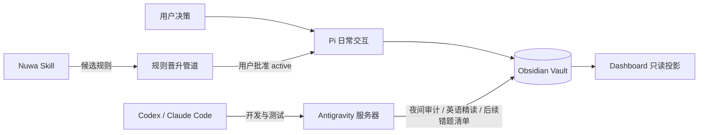

# 考研 Agent 规划系统

> 目标：用 Obsidian 保存事实与决策，用 Agent 降低记录和复盘摩擦。系统服务复习，不以功能数量作为成果。
> Agent 切换或任务中断时，从 [[HANDOFF|Agent 交接与故障切换]] 开始。

## 1. 已确认事实

| 编号 | 决策 | 依据 |
|---|---|---|
| D1 | 报考深圳大学信息工程学院通信工程，初试日期 2026-12-19 | 用户确认 |
| D2 | 目标总分 350：数学 120、英语 70、政治 60、805 100 | 用户确认 |
| D3 | 专业课官方科目代码为 802《电子信息与通信系统综合》（历年真题前身为 902，分值：信号与系统 75分 + 通信原理 75分）；教材为樊昌信《通信原理》第七版、奥本海姆《信号与系统》 | 用户于 2026-09-13 确认深大官方大纲（ehall.szu.edu.cn/gsapp/sys/zsjzapp/index.do#/2026/2/802） |
| D4 | 每天至少 9 小时学习；周五、周六、周日 22:00 后可游戏 | 用户确认；睡眠底线待补 |
| D5 | Pi 是日常交互入口；Codex/Claude Code 负责开发；Antigravity 服务器运行全部生产自动化 | 用户确认 |
| D6 | Kanban 是唯一可勾选任务源；Daily 只记事实；周复盘负责调整 | 本轮系统决策 |
| D7 | 先运行 7 天人工闭环，再试点数学错题，最后增加自动化 | 本轮系统决策 |
| D8 | 数学一是首个错题闭环试点 | 用户在 Claude 对话中选择 |
| D9 | 先用 Obsidian、Dataview 和 Agent 文件检索，不建设 RAG | 当前工程决策 |
| D10 | 博主文字稿后续经 Nuwa Skill 蒸馏，只能从候选规则逐步晋升为有效规则 | 用户确认扩展方向 |
| D11 | 本地不自动提交或推送；同步由服务器/Gitee 管理 | 既有仓库决策 |
| D12 | 自动生成英语材料只表示 processed，不表示 studied | 本轮数据决策 |
| D13 | Nuwa 可提前运行 source/candidate 蒸馏；shadow 等 M1 完成后，active 仍需用户逐条批准 | 用户提议；本轮边界决策 |
| D14 | 旧写入型夜审 cron 于 2026-08-19 停用；M1 期间不写 Daily/Kanban，07:00 英语材料 cron 保留 | 用户批准的生产变更 |
| D15 | 建立 `coordination/` 作为跨 Agent 协作交换区，按请求、提案、交接和报告组织；该目录不保存学习事实、不复制任务，也不替代各领域权威文件 | 用户于 2026-08-23 确认 |
| D16 | 采用 W35 校准计划（49 小时承诺、14 小时缓冲），并批准当前阶段进入 `S1-收尾与校准` | 用户于 2026-08-23 确认 |
| D17 | 推进 Nuwa M4a：审查 Phase 1.5 产物，并以候选规则辅助生成 W35 执行细化提案；不进入 active 或正式排程 | 用户于 2026-08-23 确认 |
| D18 | 批准执行 W35 Nuwa 细化提案，仅用于学习块和候选规则观察；不新增任务、不改正式计划、不晋升规则 | 用户于 2026-08-23 确认 |
| D19 | 将 Nuwa 上游源码、未分域原始材料和 MMG 数学领域资产分离；进入数学 Phase 2，后续按领域模块增量更新 | 用户于 2026-08-23 确认 |
| D20 | Phase 2 数学综合摘要通过用户检查；五个模型保持独立，允许进入 Phase 3 数学方法模块 Skill 草案 | 用户于 2026-08-23 确认 |
| D21 | 因本地硬件故障导致数据丢失，从 Gitee 恢复后实施全系统软复位；清空 W35 历史未完成任务且不结转负债，阶段路线图正式切入 S2-强化与真题启动，启动 W38 规划 | 用户于 2026-09-13 确认 |
| D22 | 用户授权提前完成 M1 人工闭环，直接解锁并切入 M2 数学错题闭环试点（首批 10 道真实错题以 2007 年真题错题为主线展开） | 用户于 2026-09-13 确认 |

## 2. 当前基线

- 距离初试 122 天（以 2026-08-19 计）。
- 数学：高数二刷完成；880 高数基础于 8 月 21 日告一段落，8 月 22–23 日已开始错题回炉；8 月 26 日进入高数/线代综合拼好卷；9 月 3–4 日返校后启动真题。概率论第四章例题已完成、课后自测未做，W35 以第四章自测建立质量基线。880 正确率约 60%–70%。
- 英语：从 2010 年开始，当前到 2013 Text 2；每篇阅读常错 2–3 题。
- 政治：当前维持每日做题，后期刷套卷；主观题材料与启动节点待确认。
- 805：通信原理尚未正式开始，计划 9 月启动；信号与系统一轮到 Z 变换，整体效果不佳。

详见 [[个人基线与考试事实]] 与 [[阶段路线图]]。

## 3. 系统结构



## 4. 路线图

| 里程碑 | 交付物 | 验收标准 | 状态 |
|---|---|---|---|
| M0-lite | SPEC、基线、阶段路线、模板、Kanban、Dashboard | 30 秒内看清倒计时、本周目标、今日任务和最大风险 | 已完成 |
| M1 | 7 天人工执行闭环 | 任务只出现一次；至少 6 天有真实 Daily；单次记录不超过 5 分钟；完成一次周复盘 | 已完成（用户于 2026-09-13 授权完成） |
| M2 | 10 道数学真实错题试点 | 摄取、复习、通过/失败回写可用；不打断刷题 | 进行中（2026-09-13 启动） |
| M3 | Antigravity 自动化 | dry-run、幂等、日志可审计；只执行已确认规则 | 待开始 |
| M4a | Nuwa 来源与候选蒸馏 | source/candidate 可回溯原文，不进入排程 | 进行中：Phase 4 契约测试通过，等待个人证据 |
| M4b | Nuwa 影子验证与生效 | M1 后进入 shadow；active 需真实触发证据和用户批准 | 后置 |
| M5 | 智能问答与出题 | 回答引用 Vault 来源；生成题有依据、答案和人工抽检 | 后置 |

## 5. 当前状态

| 状态 | 里程碑 |
|---|---|
| 已完成 | 审计 Vault、Manus 规则包和 Claude 对话 |
| 已完成 | 收集考试目标、时间边界和四科基线 |
| 已完成 | 锁定单一数据源与 Agent 分工 |
| 已完成 | 完成 M0-lite 文件落地 |
| 已完成 | 用户确认 2026-W34 启动计划草案并生成正式版 |
| 已完成 | 用户授权完成 M1 人工闭环，系统进入 M2 |
| 进行中 | 2026-09-13 启动 M2 数学错题闭环试点（以 2007 年真题错题为切入样本） |
| 已完成 | 2026-08-23 完成半周启动检查并校准 W35 草案 |
| 已完成 | 用户确认 W35 正式计划并批准进入 S1 |
| 进行中 | Nuwa M4a：W35 执行观察；Phase 4 契约测试已通过，等待个人证据 |
| 已完成 | 数学 Phase 2 综合摘要和 Phase 3/4 Skill 契约产物 |
| 已完成 | 用户确认 W38 正式周计划并装载看板队列 |
| 已完成 | 停用 Antigravity 旧写入型夜审 cron，保留英语材料任务 |

> 项目里程碑仅记录状态；所有可执行复选框只存在于 [[考研任务看板]]。

## 6. 暂不做

- 不在 M1 期间改造或恢复 Antigravity 写入型夜审，先验证人工闭环。
- M1 期间不恢复写入型夜审；如需观测，只允许服务器日志级 audit-only。
- 不接入 Anki、RAG、复杂排程或自动出题。
- 不把 Manus 视频摘要当作已验证学习规律。
- 不让 Nuwa 输出直接修改正式规则或计划。
- 不整理或回滚英语精读目录中的现有工作区改动。

## 7. Antigravity 远程服务器规划

Antigravity 服务器是夜间审计、资料处理和证据汇总执行器，不是第二个规划决策者。`SPEC.md` 约束服务器权限，`PROJECT.md` 提供当前路线和门槛；服务器读取权威文件后，只能生成审计报告或待批提案，不能越权修改正式计划。

当前状态：**暂缓启用新的夜间规划审计，先完成 W35 每日对照和 2026-08-30 周复盘。** W35 期间不恢复写入型 cron，不自动创建任务、不改 Daily、不改 Kanban、不改正式计划。

### 7.1 推荐执行项目

| 编号 | 用途 | 推荐时间 | 推荐阶段 | 允许输出与边界 |
|---|---|---|---|---|
| 1 | 每晚规划系统审计 | 每日 23:30，或当天 Daily 截止后 | W35 周复盘后；M1 期间最多 audit-only | 检查 Daily、Kanban、正式周计划、block id、验收证据、无声顺延和容量；只写 `coordination/reports/`，不改权威文件 |
| 2 | 次日提醒和候选建议 | 每日 06:30 | M1 通过后 | 根据已确认周计划生成次日信息和风险提示；可写报告/提案，不创建任务、不自动重排 |
| 3 | 周复盘数据汇总 | 每周日 21:30，用户完成学习后 | W35 首次完整周复盘起 | 汇总实际时长、题量、正确率、任务结果、缓冲和未完成原因，生成复盘草案；正式策略仍由用户确认 |
| 4 | 英语材料自动化 | 每日 07:00，沿用现有材料任务 | 当前已可运行 | 处理材料、生成解析和标记 `processed`；不得把 `processed` 当作 `studied`，不得替用户写学习事实 |
| 5 | Nuwa 增量来源与候选管道 | 新 transcript 到达后摄取；每日 02:00 做索引汇总 | M4a 当前可运行；新增 3–5 条同主题、出现冲突或周期复核时做综合 | 保存原文、分配 `source_id`、提取引用、分域并生成 candidate；不得写入 `rules/active/`、正式计划、Kanban 或 Daily |
| 6 | 数学错题试点辅助 | 每日 22:30，或用户提交错题后 | M1 通过、W35 复盘完成并进入 M2 后 | 生成错题草案、检查字段、提醒候选复习；通过/失败必须由真实闭卷结果决定，不自动判定 |
| 7 | 仓库、服务和数据健康检查 | 每日 02:30，与夜间批处理合并 | M1 后逐步启用；远端 Git 变更需单独批准 | 检查脚本、cron、日志、仓库分歧、vendor pinned commit、重复/异常文件和敏感信息；只报告，不自动 `pull`、merge、commit 或 push |

### 7.2 三层权限

```text
第一层：只读审计
每天运行，读取权威文件并报告异常。

第二层：报告与提案
允许写 coordination/reports/ 和 coordination/proposals/，不改权威文件。

第三层：已批准的执行任务
只对明确授权的英语处理等稳定任务开放；不开放自动改计划、改 Kanban、阶段切换或规则晋升。
```

### 7.3 推荐推进顺序

1. 当前先完成 W35 每日对照，不新增服务器行为。
2. 2026-08-30 周复盘后，再启用只读夜间审计。
3. M1 通过后，增加次日候选提醒和周复盘数据汇总。
4. M2 开始后，接入数学错题试点辅助。
5. Nuwa 继续做 source/candidate 增量管道；shadow 和 active 仍需真实证据与用户批准。
6. 最后再扩展仓库健康检查和其他稳定自动化。

## 8. 变更记录

| 日期 | 版本 | 内容 |
|---|---|---|
| 2026-08-16 | 0.1 | 初始草案 |
| 2026-08-19 | 1.0 | 按用户基线重建决策记录；执行闭环前置；统一 Agent 和数据边界 |
| 2026-08-19 | 1.1 | 完成 M0-lite；修正规划确认门槛、Dashboard 数据源和任务切换边界 |
| 2026-08-19 | 1.2 | 同步 Gitee 基线；停用旧夜审 cron；允许 Nuwa source/candidate 蒸馏提前并行 |
| 2026-08-19 | 1.3 | 增加 Dashboard 的 M 阶段投影与数学错题试点门槛 |
| 2026-08-19 | 1.4 | 增加跨 Agent 接力入口、只读预检和最小交接快照 |
| 2026-08-23 | 1.5 | 建立非权威的 Agent 协作交换区，统一请求、提案、交接与报告的存放边界 |
| 2026-08-23 | 1.6 | 完成 W34 半周启动检查；M1 转为进行中，并依据真实 Daily 校准 W35 草案 |
| 2026-08-23 | 1.7 | 用户采用 W35 校准计划并批准进入 S1；同步概率论第四章例题与自测进度 |
| 2026-08-23 | 2.3 | 记录 Antigravity 远程服务器的七类用途、推荐时间和阶段；当前暂缓启用新的夜间规划审计，先完成 W35 每日对照 |
